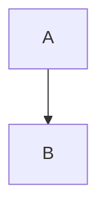

# docwatch

**Un service local qui affiche une collection de documents Markdown pendant
que d'autres processus les éditent : arborescence, rendu, rechargement
automatique, épingles — dans le navigateur.**

[](https://github.com/stephanedenis/docwatch/actions/workflows/ci.yml)
[](https://www.python.org/)
[](LICENSE)

Lire vingt fiches Markdown dans un terminal n'est pas lire. `docwatch` rend un
arbre de documents dans le navigateur, affiche les tableaux, les schémas SVG et
les images, recharge la page quand un fichier change, et garde les dossiers
importants en accès rapide.

Le nom dit ce qu'il fait : il **regarde** un ensemble de documents pendant que
d'autres processus les écrivent, et il en montre l'état courant sans jamais
toucher aux sources.

L'interface tient en deux panneaux : l'arbre des documents à gauche, le document
rendu à droite.

## Ce qu'il fait

| | |
|---|---|
| **Arborescence** | chargée à la demande, un niveau à la fois ; jamais un scan complet du disque |
| **Rendu** | Markdown → HTML (tableaux, notes de bas de page, HTML brut), dans le navigateur |
| **Rechargement** | le navigateur interroge `/stat` toutes les 3 s ; seuls les changements sont signalés, la position de lecture est conservée |
| **Épingles** | dossiers **et** documents, stockés dans `~/.config/docwatch/pins.json` |
| **Filtre temporel** | uniquement ce qui a bougé depuis 1 h, 24 h, 7 j ou N heures |
| **Images et annexes** | SVG, PNG, PDF, CSS, polices… servis avec leur type MIME, résolus contre le dossier du document |
| **Navigation** | URL propre par document (`/drave/docs/guide.md`), clic sans rechargement, Retour/Avant, liens partagés |
| **Montages** | plusieurs dépôts sur un seul port, chacun sous `/<montage>/…` |
| **Diagrammes** | sources `.puml`/`.mmd` → `<source>.svg` (affixe conservé), blocs Markdown → SVG, PlantUML et Mermaid |
| **Liens entre documents** | un lien vers un `.md` ouvre le document dans le lecteur ; `../`, espaces, ancres et `%20` sont résolus contre le document courant |
| **Documents en lecture seule** | les `.md` ne sont jamais ouverts en écriture ; seules les épingles et les SVG de diagrammes générés s'écrivent |
| **Local par construction** | le serveur n'écoute que sur `127.0.0.1` et vérifie l'en-tête `Host` |

## Installation

```bash
pipx install "git+https://github.com/stephanedenis/docwatch.git"
```

Ou, pour développer :

```bash
git clone https://github.com/stephanedenis/docwatch.git
cd docwatch
python3 -m venv .venv
. .venv/bin/activate
pip install -e ".[dev]"
```

> Le nom PyPI `docwatch` est libre et la distribution est prête ; en attendant
> la publication, l'installation se fait depuis GitHub. Les commandes installées
> sont `docwatch` et `docopen`.

## Plusieurs dépôts sur un seul port

Le fichier `~/.config/docwatch/config.toml` décrit les **montages** : chaque
dépôt reçoit un nom, qui devient le premier segment de l'URL.

```toml
[server]
port = 8771

[[mounts]]
name = "drave"
path = "~/GitHub/Qtrinet"
label = "Drave"

[[mounts]]
name = "docwatch"
path = "~/GitHub/Qtrinet/tools/docwatch"
label = "docwatch"

[diagrams]
enabled = true
plantuml = "plantuml"
mermaid = "mmdc"
timeout = 30
```

```bash
docwatch --config ~/.config/docwatch/config.toml
docwatch --init-config              # écrit un modèle dans le fichier XDG
```

Les documents sont alors servis sous `/drave/docs/…` et
`/docwatch/README.md`. Sans racine en argument, `docwatch` lit le fichier XDG
s'il existe ; avec une racine, il reste en mode mono-racine (comportement
historique).

## Utilisation

```bash
docwatch ~/Documents/docs                 # sert le dossier, ouvre le navigateur
docwatch ~/Documents/docs --port 8787     # un autre port
docwatch ~/Documents/docs --no-browser    # pour un service
docwatch                                 # sert le répertoire courant

docopen ~/Documents/docs/guide.md         # démarre le serveur si besoin et ouvre le document
docopen a.md b.md -r ~/Documents/docs     # plusieurs documents, racine explicite
```

### Épingles en ligne de commande

```bash
docwatch ~/Documents/docs --pin guide                  # épingle un dossier (relatif à la racine)
docwatch ~/Documents/docs --pin-file guide/intro.md    # épingle un document
docwatch ~/Documents/docs --unpin guide                # retire un dossier (et ses documents)
docwatch --list-pins                                # liste tout
```

### Options

| option | effet |
|---|---|
| `--port N` | port d'écoute (défaut : configuration ou `8770` ; `0` choisit un port libre) |
| `--config FICHIER` | configuration TOML multi-racines |
| `--init-config` | écrit un modèle de configuration puis quitte (`--force` pour écraser) |
| `--mount NOM` | montage des chemins relatifs pour `--pin`/`--unpin` |
| `--no-browser` | n'ouvre pas de navigateur au démarrage |
| `--config-dir DIR` | remplace `$XDG_CONFIG_HOME/docwatch` |
| `--cache-dir DIR` | remplace `$XDG_CACHE_HOME/docwatch` |
| `--pin`, `--unpin`, `--pin-file`, `--unpin-file`, `--list-pins` | gestion des épingles, sans lancer le serveur |
| `--version` | version |

## Navigation

L'URL porte le document courant :

```text
http://127.0.0.1:8771/drave/docs/guide.md
http://127.0.0.1:8771/docwatch/README.md
http://127.0.0.1:8771/drave/docs/synthese/05-la-pensee-sans-verbaliser.md#section
```

Cliquer un lien `.md` ne recharge pas la page : le client ouvre le document,
met l'URL à jour (`history.pushState`) et les boutons Retour/Avant rejouent la
navigation. Les anciennes URL `/?f=/chemin/absolu` sont acceptées et
normalisées. Un lien relatif est résolu contre le **dossier du document
courant** ; un lien absolu contre la **racine du montage courant**.

## Diagrammes

Les sources **PlantUML** `.puml`, `.pu`, `.plantuml` et **Mermaid** `.mmd`,
`.mermaid` sont converties en SVG **à côté du source**, en conservant
l'extension en affixe :

| source | SVG généré |
|---|---|
| `diagram.puml` | `diagram.puml.svg` |
| `diagram.pu` | `diagram.pu.svg` |
| `diagram.plantuml` | `diagram.plantuml.svg` |
| `diagram.mmd` | `diagram.mmd.svg` |
| `diagram.mermaid` | `diagram.mermaid.svg` |

Le Markdown pointe vers `<source>.svg` :

```markdown

```

Les blocs de code sont aussi convertis, sans fichier source :

````markdown
```puml
Alice -> Bob: bonjour
```


````

Ils sont mis en cache sous `<hash>.<affixe>.svg` et servis par
`/diagram/<hash>.<affixe>.svg`. Les SVG générés reçoivent `viewBox`, `<title>`
et `<desc>` à la racine. Un outil absent ou une erreur de syntaxe laisse le
bloc de code intact.

### Installer les outils

```bash
# PlantUML (Java), ou le paquet de votre distribution
java -jar plantuml.jar -version

# Mermaid CLI (Node + Chrome)
npm install -g @mermaid-js/mermaid-cli
mmdc --version
```

Pour Mermaid, un fichier Puppeteer peut pointer vers le Chrome du système
(`[diagrams] puppeteer = "~/.config/docwatch/puppeteer.json"`) :

```json
{"executablePath": "/usr/bin/google-chrome",
 "args": ["--no-sandbox", "--disable-gpu"]}
```

Les chemins des outils se règlent dans `[diagrams]` (`plantuml`, `mermaid`,
`timeout`). Les sources sont surveillées périodiquement ; un SVG manquant est
aussi généré à la demande quand `/asset` le sert.

## Comment ça marche

Le serveur est un `ThreadingHTTPServer` de la bibliothèque standard. Les routes
sont volontairement peu nombreuses :

| route | rôle |
|---|---|
| `GET /` | la page (arbre + lecteur) |
| `GET /<montage>/…` | la SPA d'un montage, d'un dossier ou d'un document |
| `GET /mounts` | la liste des montages |
| `GET /tree?path=…` | un niveau d'arborescence |
| `GET /render?path=…&force=0` | un document Markdown rendu en HTML |
| `GET /<chemin>.md` | la SPA pour un document (URL propre, favoris, liens partagés) |
| `GET /diagram/<hash>.<affixe>.svg` | un diagramme de bloc Markdown, généré et mis en cache |
| `GET /stat?path=…&token=…&dir_token=…` | comparaison de fraîcheur, sans rendu |
| `GET /asset?path=…` | une image, un PDF, une police — type MIME vérifié |
| `GET /pins?root=…` | les épingles visibles dans une racine |
| `GET /recent?heures=24&root=…` | les documents modifiés récemment |
| `GET /root`, `GET /status` | racine courante, périmètre, port |
| `POST /pins` | ajouter, retirer ou basculer une épingle |
| `POST /root` | restreindre la vue à un sous-dossier |
| `POST /changed` | comparaison groupée de dates (lecture seule) |

Le cache de rendu est un fichier HTML par `(chemin, mtime, taille, diagrammes)`
dans `$XDG_CACHE_HOME/docwatch` ; les diagrammes de blocs vivent dans
`$XDG_CACHE_HOME/docwatch/diagrams`. Le rendu utilise [mistune](https://mistune.lepture.com/)
et retombe sur `markdown-it-py` ou `markdown` s'il est absent.

## Sécurité

`docwatch` est un outil **local**, pas un serveur public :

- écoute uniquement sur `127.0.0.1` ;
- refuse un en-tête `Host` qui ne désigne pas `localhost` / `127.0.0.1`
  (protection contre le rebinding DNS) ;
- vérifie l'origine des `POST` ;
- résout les liens symboliques avant de comparer les chemins : impossible de
  sortir d'un **montage** par `../` ou par un lien ; les montages sont les
  bornes de sécurité ;
- ne sert par `/asset` qu'une liste fermée de types de fichiers (images,
  polices, CSS/JS, PDF, textes) — un `.env` ou une clé privée n'est jamais
  téléchargeable ;
- n'ouvre les documents qu'en lecture binaire ; les seules écritures sont les
  épingles et les SVG de diagrammes générés.

Les diagrammes exécutent **PlantUML** et **Mermaid** sur les sources locales :
ne montez que des dépôts auxquels vous faites confiance.

Le rendu HTML conserve le HTML brut du Markdown (`escape=False`) : ne servez
que des documents auxquels vous faites confiance.

## Service systemd (utilisateur)

```ini
# ~/.config/systemd/user/docwatch.service
[Unit]
Description=docwatch — lecteur Markdown local
After=default.target

[Service]
ExecStart=%h/.local/bin/docwatch --config %h/.config/docwatch/config.toml --no-browser
Restart=always
RestartSec=3

[Install]
WantedBy=default.target
```

```bash
systemctl --user daemon-reload
systemctl --user enable --now docwatch.service
```

## Développement

```bash
pip install -e ".[dev]"
pytest
ruff check .
```

Les tests couvrent le rendu, le cache, la réécriture des liens et des images,
les épingles, la traversée de chemins, les routes HTTP, les garde-fous
(`Host`, `Origin`, méthodes refusées), les montages multiples, la navigation
SPA (Chrome DevTools) et la génération PlantUML/Mermaid.

## Publication PyPI

Le nom `docwatch` est libre sur PyPI (vérifié le 27/10) et la distribution est
prête :

```bash
pip install -e ".[dev]"
python -m build
python -m twine check dist/*
python -m twine upload dist/*
```

Il faut un jeton PyPI (`~/.pypirc`, `TWINE_USERNAME=__token__` et
`TWINE_PASSWORD`). La publication par *trusted publishing* GitHub Actions est
possible sans jeton, mais demande de créer le projet sur PyPI au préalable.

## Origine

`docwatch` (anciennement `mdserve`) est extrait de l'outillage de documentation
de [Drave](https://github.com/stephanedenis/drave), où il servait à parcourir
`docs/`, `reports/` et `journal/`. Il vit désormais sa propre vie : le code ne
dépend d'aucun chemin ni d'aucune convention de ce projet.

## Licence

[MIT](LICENSE).
